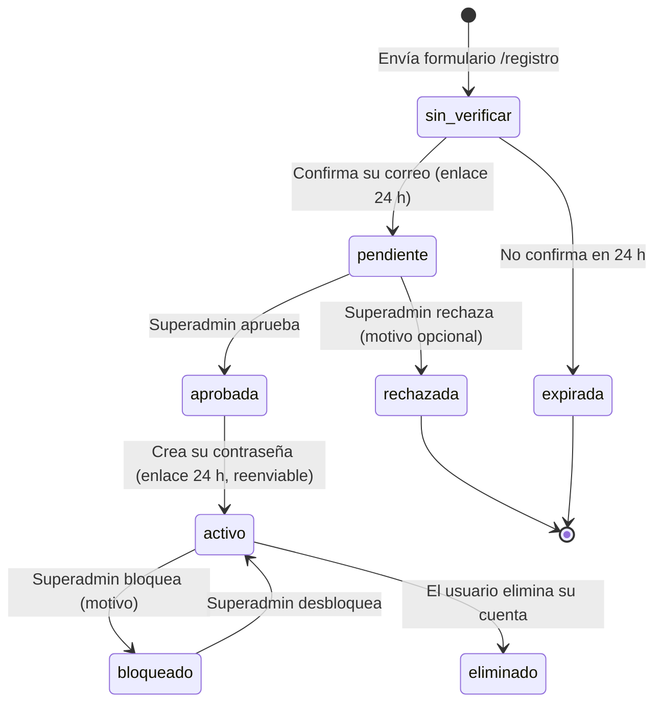

# 07 · Multiusuario: registro con aprobación y superadmin

> Evaluación y plan para abrir Plata Clara a varias personas. Cada una ve **solo** su información; el superadmin aprueba, rechaza y bloquea cuentas **sin acceder a los datos financieros** de nadie.
> Estado: **propuesta** (fase F7). Escrito el 23-nov-2026 sobre el código real de `myhub/` (migraciones F0–F6).

---

## 1. Veredicto: es viable y el costo es moderado

La app se diseñó para un usuario, pero **la base ya es multiusuario**. Lo que se verificó en el código:

| Pieza | Estado actual | ¿Sirve para varios usuarios? |
|---|---|---|
| `user_id` + RLS `user_id = auth.uid()` | En todas las tablas de negocio | ✅ Aislamiento por fila ya existe |
| Vistas (`v_*`) | Todas con `security_invoker = true` (32/32) | ✅ Respetan la RLS del usuario que consulta |
| Funciones con `p_user` (`generar_periodo_de_usuario`, `_respaldo_de`, `recordatorios_hoy`…) | `revoke` a `authenticated`, solo `service_role` | ✅ Un usuario no puede invocarlas para otro |
| Cron (`generar_periodo_todos`, recordatorios, respaldos) | Itera por usuario | ✅ Ya escala a N usuarios |
| Siembra (`inicializar_usuario` en `after insert on auth.users`) | Crea parámetros, cuenta Efectivo y categorías | ✅ Cada usuario nuevo arranca listo |
| Storage | Carpeta `{user_id}/…` con políticas | ✅ |
| Restaurar respaldo | Fuerza `user_id` de la sesión | ✅ |
| **Acceso** | Registro deshabilitado + `ALLOWED_EMAILS` en `src/lib/supabase/proxy.ts` | ❌ Hay que reemplazarlo |
| **Roles / estados de cuenta** | No existen | ❌ Nuevo |
| **Correo a terceros** | Resend con `onboarding@resend.dev` (solo entrega a tu correo) | ❌ Requiere dominio verificado |
| **Textos de Devtopia** | Tipo `reembolso_devtopia`, sección "Devtopia" en Deudas e Inicio | ⚠️ Es tuyo, no de otros usuarios: generalizar |

**Conclusión:** el trabajo está en la *puerta de entrada* (registro, aprobación, roles, bloqueo, correos) y no en rehacer el modelo de datos. Estimado: **6–9 días de desarrollo** en 5 subfases.

---

## 2. Flujo propuesto



### Paso a paso

1. **Registro** (`/registro`, pública): nombre, correo, celular (opcional), ciudad (opcional), "¿por qué quieres usar Plata Clara?" (opcional, 280 caracteres), aceptación de **Política de tratamiento de datos** y **Términos** (obligatoria). Anti‑spam: Cloudflare Turnstile + campo trampa + límite por IP.
2. **Verificación de correo** (agregado al flujo): llega "Confirma tu correo". Sin esto cualquiera podría usar tu formulario para enviar correos a direcciones ajenas, y tú recibirías solicitudes basura.
3. **Al confirmar:** la solicitud pasa a `pendiente`; al usuario le llega **"Recibimos tu solicitud"** y al superadmin **"Nueva solicitud de <nombre>"** con los datos del formulario y dos botones: *Revisar y aprobar* / *Rechazar*.
4. **Los botones del correo no aprueban solos:** abren `/admin/solicitudes/<id>` (requiere sesión de superadmin) con la acción preseleccionada y un botón de confirmación. Nunca se cambia un estado con un `GET` desde un correo (los antivirus y previsualizadores de correo abren enlaces).
5. **Aprobación:** se crea el usuario en Supabase Auth (`auth.admin.createUser`, correo ya confirmado) → el trigger existente siembra sus datos → se genera un enlace para crear contraseña (`auth.admin.generateLink`) → llega **"¡Bienvenido! Crea tu contraseña"** con instrucciones (crear contraseña, instalar la PWA, asistente "Configura tu mes en 2 minutos").
6. **Rechazo:** llega **"Tu solicitud no fue aprobada"** (con el motivo, solo si el superadmin decide incluirlo). No se crea cuenta.
7. **Uso:** el usuario ve solo lo suyo (RLS existente + nueva política restrictiva de cuenta activa). Recibe solo sus recordatorios y respaldos.
8. **Bloqueo:** el superadmin bloquea con motivo → se banea en Auth (no puede entrar ni refrescar sesión) + `perfiles.estado = bloqueado` (la RLS deja de devolverle filas aunque su token siga vigente) + correo **"Tu cuenta fue suspendida"**. Desbloquear revierte todo. Sus datos **no se borran**.

> **Decisión de diseño:** la solicitud **no crea** usuario en `auth.users` hasta aprobarla. Ventajas: no hay contraseñas guardadas de gente rechazada, no se siembran datos para cuentas spam, y la puerta de login sigue cerrada por defecto (*Allow new users to sign up* sigue **desactivado** en Supabase).

---

## 3. Qué ve el superadmin (y qué no)

| Ve | No ve |
|---|---|
| Datos del formulario de registro (nombre, correo, celular, ciudad, motivo) | Movimientos, cuentas, tarjetas, deudas, presupuestos, metas, salud financiera |
| Estado, rol, fecha de solicitud / aprobación / último ingreso | Saldos, montos o conteos de registros |
| Motivos de bloqueo y su propia bitácora de administración | Comprobantes ni respaldos de otros |
| Métricas agregadas: n.º de usuarios por estado, solicitudes del mes | Nada que permita inferir la situación financiera de alguien |

**Cómo se garantiza:**
- **No se agrega ninguna excepción de RLS para el superadmin** en tablas financieras. Su rol solo abre `solicitudes_registro`, `perfiles` y `admin_bitacora`.
- El panel lee con la **sesión del superadmin** (no con la secret key). La secret key se usa solo en las Server Actions de Auth (crear, banear, generar enlace), y cada una verifica primero `es_superadmin()` en el servidor.
- Las funciones `admin_*` son `security definer` y devuelven columnas explícitas (nunca `select *`).
- Prueba automática de aislamiento (sección 8) que falla si alguna tabla o vista nueva queda sin RLS.

> ⚠️ **Transparencia necesaria:** como dueño del proyecto de Supabase, técnicamente tú sí *podrías* leer la base desde el panel de Supabase o con la secret key. La app no te lo permite, pero la infraestructura sí. Eso debe decirse en la Política de tratamiento ("el administrador no accede a tus datos financieros por la aplicación; el acceso técnico a la infraestructura se limita a mantenimiento y queda registrado"). Cifrar extremo a extremo los datos de cada usuario eliminaría ese acceso, pero rompería las vistas y funciones SQL de análisis: **fuera de alcance**.

---

## 4. Modelo de datos (migración `2026112X000100_multiusuario.sql`)

### 4.1 Enums
| Enum | Valores |
|---|---|
| `rol_usuario` | `superadmin`, `usuario` |
| `estado_cuenta` | `activo`, `bloqueado` |
| `estado_solicitud` | `sin_verificar`, `pendiente`, `aprobada`, `rechazada`, `expirada` |

### 4.2 `solicitudes_registro`
id · nombre · email (`citext`) · celular · ciudad · motivo · acepto_politica_version · acepto_en · ip_hash (sha256 + sal, nunca la IP en claro) · user_agent · token_verificacion_hash · verificado_en · estado · revisado_por · revisado_en · motivo_rechazo · motivo_rechazo_visible `boolean` · user_id (al aprobar) · created_at
- Único parcial: un solo `email` en estado `sin_verificar | pendiente`.
- RLS: **sin políticas para `anon` ni `authenticated`**. La escribe la Server Action con la secret key; el superadmin la lee vía `admin_listar_solicitudes()`.

### 4.3 `perfiles` (1 por usuario de Auth)
user_id PK → `auth.users` · rol · estado · nombre · celular · ciudad · solicitud_id · aprobado_por · aprobado_en · bloqueado_en · motivo_bloqueo · ultimo_ingreso · created_at · updated_at
- RLS: el usuario **lee** su fila; edita nombre/celular/ciudad con `actualizar_mi_perfil()` (no puede tocar `rol` ni `estado`).
- `inicializar_usuario` crea también su fila en `perfiles`.
- **Backfill:** el usuario de Auth más antiguo (`min(created_at)`, hoy tu cuenta) queda como `superadmin`; se valida contra la variable `SUPERADMIN_EMAIL`.
- Índice único parcial `where rol = 'superadmin'` → exactamente uno (ver §7.2 para un admin de respaldo).

### 4.4 `admin_bitacora`
id · admin_id · accion (`aprobar`, `rechazar`, `bloquear`, `desbloquear`, `reenviar_invitacion`, `eliminar_solicitud`) · objetivo_user_id · objetivo_solicitud_id · detalle jsonb · creado_en
- Solo inserción; nadie puede editar ni borrar (ni el superadmin).

### 4.5 Funciones
| Función | Quién | Qué hace |
|---|---|---|
| `es_superadmin()` | authenticated | `perfiles.rol = 'superadmin' and estado = 'activo'` para `auth.uid()` |
| `cuenta_activa()` | authenticated | `perfiles.estado = 'activo'` para `auth.uid()` (stable, security definer) |
| `admin_listar_solicitudes(p_estado)` / `admin_listar_usuarios(p_texto)` | superadmin | Columnas de registro y estado únicamente |
| `admin_resumen()` | superadmin | Conteos por estado (usuarios y solicitudes) |
| `admin_registrar(p_accion, …)` | service_role | Escribe en `admin_bitacora` |
| `eliminar_mi_cuenta()` | authenticated | Marca para borrado (gracia 15 días, §7) |

### 4.6 Política restrictiva de cuenta activa
Se agrega a **todas** las tablas con `user_id` (bucle `do $$ … $$` sobre `information_schema.columns`), sin tocar las políticas actuales:
```sql
create policy "cuenta_activa" on <tabla> as restrictive
  for all to authenticated
  using ((select public.cuenta_activa()))
  with check ((select public.cuenta_activa()));
```
Las restrictivas se combinan con `AND` con la política "propietario": un bloqueado deja de leer y escribir **al instante**, aunque su JWT siga vigente hasta 1 h. El `(select …)` hace que Postgres la evalúe una sola vez por consulta.

### 4.7 Ajustes a lo existente
- `recordatorios_hoy`, `generar_periodo_todos` y el respaldo dominical: **omitir** cuentas bloqueadas o en borrado.
- `bitacora` existente sigue siendo por usuario (no se mezcla con `admin_bitacora`).

---

## 5. Aplicación (Next.js)

### 5.1 Rutas nuevas
| Ruta | Acceso | Contenido |
|---|---|---|
| `/registro` | pública | Formulario + Turnstile + aceptación legal |
| `/registro/enviada` | pública | "Revisa tu correo para confirmarlo" |
| `/registro/confirmar?token=` | pública | Valida token → `pendiente` → envía los dos correos → "Tu solicitud está en revisión" |
| `/cuenta/crear-contrasena` | sesión de invitación | Fija contraseña (mín. 10, medidor de fuerza) → asistente inicial |
| `/legal/privacidad`, `/legal/terminos` | pública | Textos versionados |
| `/admin` | superadmin | Resumen: pendientes, activos, bloqueados |
| `/admin/solicitudes` y `/[id]` | superadmin | Lista con filtros; detalle con Aprobar / Rechazar (motivo + "mostrar motivo al usuario") |
| `/admin/usuarios` y `/[id]` | superadmin | Datos de registro, estado, último ingreso, bitácora; Bloquear / Desbloquear / Reenviar invitación |
| `/configuracion/cuenta` | usuario | Mis datos, cambiar contraseña, MFA, descargar mis datos, eliminar mi cuenta |

### 5.2 Cambios en piezas actuales
- `src/lib/supabase/proxy.ts`: se elimina la lista blanca. Nueva lógica: rutas públicas (`/login`, `/registro*`, `/legal/*`, `/auth/confirm`) → libres; con sesión → consultar `perfiles` (estado y rol; una consulta ligera) → bloqueado: cerrar sesión y `/login?error=cuenta-suspendida`; `/admin/*` sin rol superadmin → 404 (no revelar que existe).
- `ALLOWED_EMAILS` se reemplaza por `SUPERADMIN_EMAIL` (solo para el backfill y como verificación de arranque).
- Login: mensajes nuevos ("Tu cuenta está suspendida", "Tu acceso aún no ha sido aprobado") + enlace "¿No tienes cuenta? Solicita acceso".
- Menú de usuario: entrada **Administración** solo para el superadmin.
- **Generalizar Devtopia:** `parametros.nombre_reembolsos` (por defecto *"Mi empresa"*; en tu cuenta, *"Devtopia"*). Los textos de UI usan ese valor; el enum `reembolso_devtopia` se conserva internamente para no migrar datos. Para usuarios nuevos la sección aparece apagada hasta activarla en Configuración.

### 5.3 Server Actions (`src/actions/registro.ts`, `src/actions/admin.ts`)
Todas validan con Zod, verifican rol en servidor, escriben en `admin_bitacora` y son idempotentes (aprobar dos veces no crea dos usuarios: se comprueba `estado = 'pendiente'` con `update … returning`).

---

## 6. Correos (Resend + plantillas React Email)

| # | Correo | Para | Disparador |
|---|---|---|---|
| 1 | Confirma tu correo | Solicitante | Envía formulario |
| 2 | Recibimos tu solicitud | Solicitante | Confirma correo |
| 3 | Nueva solicitud: <nombre> (datos + botones) | Superadmin | Confirma correo |
| 4 | ¡Bienvenido! Crea tu contraseña (+ primeros pasos) | Usuario | Aprobación / reenvío |
| 5 | Tu solicitud no fue aprobada | Solicitante | Rechazo |
| 6 | Tu cuenta fue suspendida / reactivada | Usuario | Bloqueo / desbloqueo |
| 7 | Recordatorios de vencimiento (ya existe) | Cada usuario, solo lo suyo | Cron diario |
| 8 | Resumen semanal de solicitudes pendientes (opcional) | Superadmin | Cron lunes, si hay > 0 |

**Requisitos de infraestructura:**
- **Dominio verificado en Resend** (p. ej. `plata.devtopia.co` con SPF, DKIM y DMARC). Sin esto Resend solo entrega a tu propio correo.
- `EMAIL_FROM=Plata Clara <hola@plata.devtopia.co>`, `EMAIL_REPLY_TO` a un buzón real.
- **SMTP personalizado en Supabase** (Authentication → SMTP) apuntando a Resend, para que "Olvidé mi contraseña" y los enlaces mágicos no dependan del SMTP de prueba de Supabase (muy limitado y no apto para usuarios reales).
- Los correos nunca incluyen datos financieros; el n.º 3 incluye solo los datos del formulario.

---

## 7. Funcionalidades adicionales recomendadas

### 7.1 Imprescindibles (entran en F7)
1. **Verificación de correo antes de notificar** (ya incluida en el flujo).
2. **Anti‑abuso:** Turnstile, campo trampa, máx. 3 solicitudes por IP/día y 1 activa por correo; tope configurable de usuarios activos (`parametros_sistema.max_usuarios`) con mensaje "cupo lleno, te avisamos".
3. **Cumplimiento Ley 1581 de 2012 (habeas data):** autorización previa, expresa e informada (casilla no premarcada + versión de la política guardada), Política de tratamiento publicada, canal para consultas y reclamos, y derechos de conocer, actualizar, rectificar y suprimir → resueltos con *Descargar mis datos* (ya existe el respaldo JSON/Excel) y *Eliminar mi cuenta*.
4. **Eliminar mi cuenta (autoservicio):** confirmación escribiendo el correo → 15 días de gracia (puede cancelar entrando) → el cron borra datos, comprobantes, respaldos y el usuario de Auth; queda en `admin_bitacora` solo "cuenta eliminada" sin datos personales.
5. **MFA (TOTP) obligatorio para el superadmin** y opcional para usuarios (Supabase Auth ya lo soporta). Si tu cuenta es la llave de todo, una contraseña sola no basta.
6. **Retención de solicitudes:** rechazadas y expiradas se purgan a los 90 días (cron diario).
7. **Prueba de aislamiento automatizada** (§8).

### 7.2 Muy recomendables (F7.5 u opcional)
8. **Invitación directa:** el superadmin escribe un correo y envía la invitación sin formulario (familia, pareja).
9. **Superadmin de respaldo / transferencia de rol:** si pierdes acceso a tu correo, nadie puede administrar. Opción: un segundo `superadmin` con MFA, o un procedimiento documentado de recuperación por SQL.
10. **Avisos de seguridad al usuario:** "nuevo inicio de sesión", "tu contraseña cambió".
11. **Cuentas inactivas:** aviso a los 6 meses sin ingresar; nunca borrado automático sin aviso.

### 7.3 A futuro (si se vuelve producto de Devtopia)
12. **Espacios compartidos** (pareja / hogar): un "hogar" con miembros e invitaciones, donde ciertas cuentas y obligaciones son compartidas. Cambia el modelo de RLS de `user_id` a `espacio_id`: conviene decidirlo **antes** de tener muchos usuarios.
13. **Planes y pagos** (Wompi / Mercado Pago), límites por plan.
14. **Soporte sin datos:** "Reportar un problema" que adjunta solo metadatos técnicos, nunca cifras.

---

## 8. Seguridad y pruebas

- **Prueba de aislamiento (Vitest + PGlite, como las de migraciones actuales):** crea usuarios A y B con datos completos; con la sesión de B recorre **todas** las tablas y vistas (`information_schema`) y exige 0 filas de A; intenta `insert/update/delete` con ids de A y exige error; llama cada función expuesta a `authenticated` con ids de A. Una tabla nueva sin RLS rompe el CI.
- **Prueba de rol:** usuario normal → `/admin` da 404 y `admin_*` lanza error; superadmin → `admin_listar_usuarios` no contiene columnas financieras (comparación con lista permitida).
- **Prueba de bloqueo:** con token aún vigente, tras bloquear, las consultas devuelven 0 filas.
- **E2E (Playwright + Mailpit local):** registro → confirmar → correo al admin → aprobar → crear contraseña → login → asistente; rechazo; bloqueo y desbloqueo.
- Secret key solo en servidor (ya es así); `admin.ts` con `import "server-only"`.
- Encabezados y `noindex` actuales se mantienen; `/registro` sí puede ser indexable si quieres captar usuarios (decisión tuya).

---

## 9. Plan de trabajo (F7)

| Subfase | Entregable | Esfuerzo | Criterio de aceptación |
|---|---|---|---|
| **F7.0 Preparación** | Dominio en Resend, SMTP en Supabase, Turnstile, textos legales borrador, decidir §11 | 0,5 d | Correo de prueba llega a un Gmail ajeno |
| **F7.1 Base de datos** | Migración multiusuario, backfill superadmin, política restrictiva, ajustes de cron, **pruebas de aislamiento y rol** | 1,5–2 d | `pnpm check` verde; prueba de aislamiento cubre 100 % de tablas/vistas |
| **F7.2 Registro público** | `/registro`, confirmación, anti‑abuso, páginas legales, correos 1–3 | 1,5 d | Solicitud llega al admin solo tras confirmar correo |
| **F7.3 Panel superadmin** | `/admin`, solicitudes, aprobar/rechazar, invitación, crear contraseña, correos 4–5, bitácora | 1,5–2 d | Flujo completo E2E en local con Mailpit |
| **F7.4 Gestión y cuenta** | Bloquear/desbloquear (Auth ban + estado), correo 6, `/configuracion/cuenta`, eliminar cuenta, MFA admin, generalizar Devtopia | 1,5 d | Bloqueado pierde acceso en < 1 min; borrado elimina todo tras la gracia |
| **F7.5 Cierre** | Invitación directa, aviso semanal al admin, purgas, docs (04, 05, PUESTA-EN-MARCHA), checklist F7 | 0,5–1 d | Checklist de aceptación F7 completo en producción |

**Total: 6–9 días.** Orden recomendado: F7.1 primero y sola en un PR, porque su prueba de aislamiento protege todo lo demás.

---

## 10. Infraestructura y costos

| Servicio | Situación con varios usuarios |
|---|---|
| Supabase Free | Holgado para decenas de usuarios (el volumen por usuario es bajo, < 3.000 movimientos/año). Vigilar 500 MB de base y 1 GB de Storage (comprobantes). El cron diario ya evita la pausa por inactividad. |
| Vercel Hobby | Válido para uso personal/no comercial. **Si se ofrece a terceros como servicio o se cobra, pasar a Pro.** |
| Resend | El plan gratuito suele bastar para este volumen; confirmar límites vigentes al configurar. |
| Cloudflare Turnstile | Gratis. |

**Legal (Colombia):** quien administre la app es *Responsable del tratamiento* bajo la Ley 1581 de 2012 y debe cumplir autorización, política y atención de derechos (§7.1‑3). La inscripción en el Registro Nacional de Bases de Datos de la SIC hoy solo es obligatoria para sociedades y entidades sin ánimo de lucro con activos superiores a 100.000 UVT y entidades públicas (Decreto 090 de 2018), así que probablemente no aplique ni a ti como persona natural ni a Devtopia; conviene confirmarlo con un abogado si la app pasa a nombre de Devtopia. Los datos financieros no son "datos sensibles" en sentido legal, pero sí de alto impacto: trátalos como tales.

---

## 11. Decisiones pendientes (con recomendación)

| Decisión | Recomendación |
|---|---|
| ¿Quién es el Responsable del tratamiento: tú o Devtopia? | Tú como persona natural mientras sea uso entre conocidos; Devtopia si se vuelve producto. |
| Dominio de correo | `plata.devtopia.co` |
| ¿Mostrar el motivo de rechazo al usuario? | Opcional por solicitud (casilla), por defecto no |
| Tope de usuarios activos | 25 al inicio |
| ¿Espacios compartidos (pareja/hogar)? | Decidir antes de abrir el registro; si es probable, diseñar `espacio_id` desde F7.1 |
| ¿Indexar `/registro` en buscadores? | No, mientras sea por invitación informal |

---

## 12. Checklist de aceptación de la Fase 7

- [ ] Sin sesión, `/registro` muestra el formulario; sin aceptar la política no deja enviar.
- [ ] Al enviar llega "Confirma tu correo"; sin confirmar, el superadmin no recibe nada y a las 24 h la solicitud expira.
- [ ] Al confirmar llegan "Recibimos tu solicitud" (al usuario) y "Nueva solicitud" (al superadmin) con los datos del formulario.
- [ ] El botón del correo abre el detalle en `/admin`, pide confirmación y no aprueba al solo abrir el enlace.
- [ ] Aprobar envía "Crea tu contraseña"; el usuario la crea, entra y ve el asistente con 0 movimientos y las categorías por defecto.
- [ ] Con dos usuarios, ninguno ve cifras, cuentas, comprobantes, respaldos ni recordatorios del otro.
- [ ] Rechazar envía el correo de rechazo y no crea usuario en Auth.
- [ ] Un usuario normal que abre `/admin` recibe 404.
- [ ] En `/admin/usuarios/<id>` solo aparecen datos de registro, estado y fechas; ningún monto.
- [ ] Bloquear: el usuario es expulsado en < 1 min, no puede volver a entrar y recibe el correo; desbloquear lo restablece con sus datos intactos.
- [ ] Toda acción del superadmin queda en la bitácora de administración.
- [ ] *Eliminar mi cuenta* pide confirmación, se puede cancelar en 15 días y luego borra todo.
- [ ] El superadmin no puede bloquearse ni quitarse el rol a sí mismo.
- [ ] `pnpm check` incluye y pasa la prueba de aislamiento.
