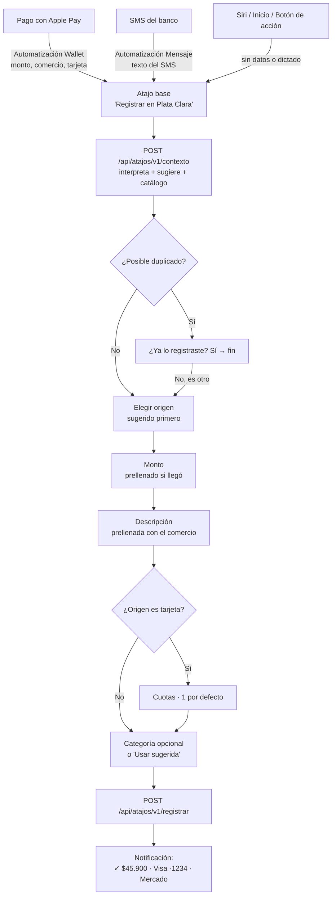

# 08 · Captura desde iPhone: Atajos con Wallet, SMS del banco y registro rápido

> Evaluación y plan para registrar gastos sin abrir la app: un **Atajo de iPhone** pregunta *origen, monto y descripción* (fecha = hoy) y lo envía a Plata Clara. Tres disparadores: **pago con Wallet (Apple Pay)**, **SMS del banco** y **registro rápido manual** (Siri, pantalla de inicio, botón de acción).
> Estado: **F8.1–F8.4 implementadas** (24-nov-2026: base de datos, intérprete, API, pantallas y guía de atajos). Pendientes: F8.0 (SMS reales de tus bancos) y armar los atajos en el iPhone con la guía (§14, `PUESTA-EN-MARCHA.md` §15). Lo implementado y sus diferencias con este diseño están en los §12–§14.

---

## 1. Veredicto: viable, con tres ajustes al planteamiento original

La idea funciona con lo que iOS ofrece hoy: la automatización **Wallet / Transacción** (iOS 17+) entrega al atajo *tarjeta, comercio, monto y nombre*; la automatización **Mensaje** se dispara por remitente o por texto y entrega el contenido del SMS; ambas pueden configurarse para **ejecutarse de inmediato**. Lo que falta está del lado de Plata Clara: hoy solo se escribe con sesión de navegador (cookies + Server Actions), y un atajo no tiene esa sesión.

| Pieza | Estado actual | Qué hace falta |
|---|---|---|
| Escritura de movimientos | `guardarMovimiento` (Server Action, sesión por cookies) | **API propia para atajos** con token personal |
| Protección de rutas | `src/proxy.ts` redirige a `/login` todo lo que no sea público | Excluir `api/atajos/` del matcher (se autentica con token, como `api/cron/`) |
| Triggers de BD | `movimiento_asignar_periodo`, `validar_movimiento` usan `NEW.user_id`, no `auth.uid()` | ✅ Sirven tal cual para una función `security definer` que fije `user_id` |
| Compras con tarjeta | Tabla aparte `compras_tc` (deuda a capital, cuotas) | El atajo debe **enrutar**: origen tarjeta → `compras_tc`; origen cuenta → `movimientos` |
| Categoría | **Obligatoria** en gasto (`movimientoSchema`) | Sugerencia automática + categoría de sistema **Por clasificar** + bandeja de revisión |
| Comercios | `v_comercios_mes` ya normaliza la clave del comercio | ✅ Base para sugerir categoría por historial |

**Los tres ajustes (complementos al feature):**

1. **El origen puede ser una tarjeta de crédito.** Con Apple Pay lo normal es pagar con tarjeta de crédito; si se registrara como "gasto" de una cuenta, se descuadrarían el libro mayor de la tarjeta y el checklist del mes. El atajo ofrece cuentas **y** tarjetas en la misma lista, y si eliges una tarjeta pregunta además *cuotas* (por defecto 1) y crea una `compra_tc`.
2. **La categoría no puede quedar vacía**, pero tampoco conviene una cuarta pregunta obligatoria. Se sugiere sola (por comercio y por historial); si no hay sugerencia confiable queda en *Por clasificar* y aparece en una **bandeja "Por revisar"** en Inicio. La pregunta de categoría es opcional en el atajo.
3. **Un mismo pago dispara dos veces** (Wallet + SMS del banco para la misma compra). Hay **detección de duplicados**: mismo origen, mismo monto, ±15 min → el atajo pregunta "¿Ya registraste $45.900 en Éxito hace 3 min?" en lugar de duplicar.

Estimado: **5–6 días** en 5 subfases (§9).

---

## 2. Los tres flujos



**Un solo atajo base** ("Registrar en Plata Clara") hace todo el trabajo; las automatizaciones y los accesos rápidos solo lo llaman con datos distintos. Así, un cambio se hace en un lugar.

### 2.1 Pago con Wallet (Apple Pay)

- **Disparador:** Atajos → Automatización → **Wallet** (en iOS 17–25 aparece como *Transacción*) → elegir tarjetas → **Ejecutar inmediatamente**.
- **Datos que llegan:** tarjeta (nombre en Wallet), comercio, monto, nombre de la transacción.
- **Mapeo tarjeta → origen:** la primera vez que llega "Visa Bancolombia", eliges el origen y Plata Clara **aprende el alias**; las siguientes veces viene preseleccionado (tabla `alias_origen`, §4.3).
- **Limitaciones reales a considerar (verificar con tus tarjetas en F8.0):**
  - El monto **no siempre llega** con tarjetas que no son Apple Card; hay reportes de llegar en 0 o con el comercio vacío. Por eso el monto se *prellena* y siempre se confirma.
  - La automatización espera la notificación de Wallet y **a veces expira** si llega tarde. Si falla, el SMS del banco sirve de respaldo (y la detección de duplicados evita el doble registro cuando llegan los dos).
  - Solo aplica a pagos **con el iPhone/Watch**; una compra con la tarjeta física no dispara nada (la cubre el SMS).
- **Modo configurable** en el atajo (variable al inicio):
  - **Preguntar** (por defecto, lo que pediste): confirma origen, monto, descripción.
  - **Automático**: si llegaron monto, comercio y un alias conocido, registra sin preguntar, lo marca *por revisar* y solo muestra la notificación. Útil para no frenar en la caja.

### 2.2 SMS del banco (compra o transferencia)

- **Disparador:** Automatización → **Mensaje** → *Remitente* = contacto del banco (crea un contacto "Bancolombia SMS", "Davivienda SMS"… con el número corto desde el que te escriben) → **Ejecutar inmediatamente**. Una automatización por banco.
  - Alternativa: *El mensaje contiene* "compra" / "transferencia", pero iOS acepta **una frase por automatización** y es más propenso a falsos positivos. Recomendado: por remitente.
- **Datos que llegan:** el texto completo del SMS. **La interpretación se hace en el servidor**, no en el atajo: las expresiones regulares en Atajos son frágiles y difíciles de mantener, y cada banco escribe distinto. El servidor devuelve monto, comercio/destinatario, últimos 4 dígitos, tipo (compra, transferencia enviada, transferencia recibida, retiro, pago) y origen sugerido.
- **Tipos que se manejan:**
  | El SMS dice | Se registra como | Notas |
  |---|---|---|
  | Compra con tarjeta de crédito *1234 | `compra_tc` en esa tarjeta | Pregunta cuotas |
  | Compra con débito / pago PSE | `gasto` desde la cuenta | |
  | Transferiste a un tercero | `gasto` (o pago de obligación si coincide, §7.2) | |
  | Transferiste a una cuenta tuya | `transferencia` | Si reconoce el destino como cuenta propia |
  | Recibiste una transferencia | `ingreso` | Pregunta categoría de ingreso |
  | Retiro en cajero | `transferencia` cuenta → Efectivo | |
  | SMS que no es de movimiento (clave, publicidad, saldo) | Nada: el atajo termina en silencio | `contexto` responde `{accion: "ignorar"}` |
- **Privacidad del SMS:** el servidor quita saldos disponibles y enmascara números largos antes de guardar nada; el texto se guarda solo como evidencia en la captura (§4.4) y se **purga a los 30 días**.
- **Limitación:** la automatización Mensaje solo ve **SMS/iMessage**. Muchas apps bancarias (y billeteras como Nequi o Daviplata) avisan por **notificación push**, que este disparador no captura. Para esos casos queda el registro rápido.

### 2.3 Registro rápido (manual)

Atajo "Gasto rápido" que llama al atajo base sin datos. Accesos:
- **Siri:** "Oye Siri, gasto rápido".
- **Pantalla de inicio / widget** de Atajos, **Centro de control**, **botón de acción** (iPhone 15 Pro en adelante), **Toque posterior** (Accesibilidad → Tocar → Toque atrás).

Flujo: *¿Gasto o ingreso?* (Gasto por defecto) → origen (el último usado primero) → monto → descripción → categoría opcional → registrar.

**Complemento — modo dictado:** si eliges "Dictar", dices *"Gasté 25 mil en almuerzo con Nequi"* y el mismo intérprete del servidor extrae monto ("25 mil", "25.000", "25k"), descripción y origen por nombre o alias. El atajo solo confirma.

---

## 3. Arquitectura

```
iPhone (Atajos)                       Vercel (Next.js)                         Supabase
──────────────                        ────────────────                         ────────
Atajo base ── Authorization: Bearer ─▶ /api/atajos/v1/contexto  ──rpc──▶ atajo_contexto(token_hash, …)
              pc_xxxxxxxx…            /api/atajos/v1/registrar ──rpc──▶ atajo_registrar(token_hash, …)
                                       (sin sesión, sin secret key)          security definer:
                                       - valida forma con Zod                 1. resuelve user por token
                                       - límite de frecuencia                 2. verifica cuenta activa (F7)
                                       - interpreta SMS/dictado (TS puro)     3. valida pertenencia de ids
                                                                              4. inserta con user_id explícito
                                                                              → triggers existentes hacen el resto
```

### 3.1 Decisiones

| Decisión | Elegido | Por qué |
|---|---|---|
| Autenticación | **Token personal** (`pc_` + 32 bytes aleatorios), se muestra una sola vez; en BD solo `sha256` | Atajos no puede guardar ni refrescar una sesión de Supabase. Revocable sin cambiar tu contraseña. |
| Cómo se escribe en BD | Funciones `security definer` llamadas con la **llave publicable** | La ruta **no usa la secret key**: el token es la credencial y la función fija `user_id`. Menos superficie que bypassear RLS desde el servidor. |
| Alcance del token | Solo `contexto` y `registrar` | Un token robado permite registrar gastos, **no leer** saldos, historial ni datos. El catálogo solo trae nombres de cuentas/categorías. |
| Dónde se interpreta el SMS | Servidor, `lib/domain/interpretar.ts` (TS puro con pruebas) | Mantenible, probado con SMS reales, mejora sin tocar el iPhone. |
| Abrir la PWA con parámetros vs. API | **API** (con "Abrir en Plata Clara" como salida opcional) | En iOS la PWA instalada no comparte cookies con Safari: abrir un enlace caería en Safari sin sesión. Además las preguntas nativas son más rápidas. |
| Fecha | `hoy` en America/Bogota **calculada en el servidor**; el atajo envía además su hora local como dato de control | Evita desfases a medianoche y teléfonos con zona errada. |
| Montos | El atajo envía texto; el servidor normaliza `45.900`, `45,900.00`, `$ 45.900,00`, `45k`, `45 mil` | La entrada numérica de iOS varía con la región del teléfono. |
| Versionado | `/api/atajos/v1/…` | Los atajos instalados no se actualizan solos; la v1 debe seguir funcionando aunque haya v2. |

### 3.2 Contrato de la API

**`POST /api/atajos/v1/contexto`** — una sola llamada antes de preguntar (rapidez en la caja).

```jsonc
// Petición (todos los campos opcionales)
{
  "fuente": "wallet" | "sms" | "rapido" | "dictado",
  "wallet": { "tarjeta": "Visa Bancolombia", "comercio": "EXITO CHAPINERO", "monto": "45900" },
  "texto": "Bancolombia: Compraste $45.900,00 en EXITO CHAPINERO con tu T.Cred *1234 …",
  "hora_local": "2026-11-23T19:42:10-05:00"
}
// Respuesta
{
  "accion": "preguntar" | "ignorar" | "registrar_directo",
  "tipo": "gasto",
  "monto": 45900,
  "descripcion": "Éxito Chapinero",
  "origen_sugerido": "Visa Bancolombia ·1234",
  "categoria_sugerida": "Mercado",
  "cuotas_sugeridas": 1,
  "posible_duplicado": { "hace_min": 3, "texto": "¿Ya registraste $45.900 en Éxito hace 3 min?" } | null,
  "origenes":   { "💳 Visa Bancolombia ·1234": "t:uuid", "🏦 Ahorros Bancolombia": "c:uuid", "📱 Nequi": "c:uuid", "💵 Efectivo": "c:uuid" },
  "categorias": { "✨ Usar sugerida (Mercado)": "auto", "🛒 Mercado": "uuid", "🍽️ Restaurantes": "uuid", "🚕 Transporte": "uuid", "…": "…", "📥 Por clasificar": "pendiente" }
}
```
- `origenes` y `categorias` son **diccionarios etiqueta → id**: en Atajos se usa *Elegir de la lista* sobre las claves y *Obtener valor del diccionario* para el id, sin lógica extra. Vienen **ordenados**: sugerido primero, luego por uso en los últimos 60 días; categorías limitadas a las 10 más usadas + *Por clasificar*.
- Prefijo `t:` = tarjeta de crédito, `c:` = cuenta; en ambos casos el id es el **de la cuenta** (las tarjetas también son cuentas). El atajo pregunta cuotas si el valor empieza por `t:`.

**`POST /api/atajos/v1/registrar`**

```jsonc
{
  "fuente": "sms",
  "tipo": "gasto" | "ingreso",
  "origen": "t:uuid",
  "monto": "45.900",
  "descripcion": "Éxito Chapinero",
  "categoria": "auto" | "pendiente" | "uuid",
  "cuotas": 1,
  "alias": { "wallet_tarjeta": "Visa Bancolombia" } ,   // para aprender el mapeo
  "clave": "20261123194210-45900-a7"                  // idempotencia (fecha + monto + aleatorio del atajo)
}
// 201
{ "ok": true, "id": "uuid", "registro": "compra_tc", "por_revisar": false,
  "mensaje": "✓ $45.900 en Visa ·1234 · Mercado · 1 cuota" }
// 200 si la clave ya existía (reintento): misma respuesta, no duplica
// 4xx: { "ok": false, "mensaje": "La tarjeta está inactiva" }  → el atajo lo muestra tal cual
```
- Mensajes siempre listos para *Mostrar notificación*; el atajo no arma textos.
- Errores de red: el atajo reintenta una vez con la **misma clave** (seguro gracias a la idempotencia).

---

## 4. Modelo de datos (migración `2026112X000200_atajos.sql`)

### 4.1 `tokens_api`
id · user_id · nombre ("iPhone de Omar") · token_hash `bytea` (sha256, único) · prefijo (`pc_a1b2`, para reconocerlo en la lista) · alcances `text[]` (`{registrar}`) · creado_en · ultimo_uso_en · ultimo_uso_fuente · expira_en (null = no expira) · revocado_en
- RLS: el dueño **lee** sus filas (sin `token_hash`) vía vista `v_tokens_api`; crear y revocar por funciones `crear_token_api(p_nombre) → text` (devuelve el token en claro **una vez**) y `revocar_token_api(p_id)`.
- Máx. 5 tokens activos por usuario.

### 4.2 Columnas nuevas en `movimientos` y `compras_tc`
| Columna | Tipo | Nota |
|---|---|---|
| `origen_registro` | text, check (`app`, `atajo_wallet`, `atajo_sms`, `atajo_rapido`, `atajo_dictado`) default `app` | Para filtrar, medir uso y depurar |
| `por_revisar` | boolean default false | Alimenta la bandeja; se apaga al editar o al pulsar "Está bien" |
| `clave_idempotencia` | text null | Único parcial `(user_id, clave_idempotencia) where clave_idempotencia is not null` |

### 4.3 `alias_origen` (aprendizaje del mapeo)
id · user_id · tipo (`wallet_tarjeta`, `sms_ultimos4`, `sms_remitente`, `nombre_dictado`) · valor (normalizado) · cuenta_id · tarjeta_id · usos · ultimo_uso
- Único `(user_id, tipo, valor)`. Se crea/actualiza en `atajo_registrar` cuando llega `alias`.
- ~~`cuentas` agrega `ultimos4`~~ — descartado en la implementación: los últimos 4 de una cuenta de ahorros se aprenden como alias `sms_ultimos4` la primera vez que eliges el origen.

### 4.4 `capturas_atajo` (bitácora técnica, sin cifras sensibles)
id · user_id · token_id · fuente · resultado (`registrado`, `duplicado_confirmado`, `ignorado`, `error`) · error · movimiento_id / compra_tc_id · texto_enmascarado (solo SMS, sin saldos) · ms (latencia) · creado_en
- Purga a 30 días (cron diario existente). Se ve en Configuración → Atajos → *Actividad reciente*; sirve para ajustar el intérprete con SMS reales que no entendió.

### 4.5 Funciones
| Función | Quién la llama | Qué hace |
|---|---|---|
| `atajo_contexto(p_token_hash, p_datos jsonb)` | `anon` (la ruta) | Resuelve usuario, devuelve catálogo ordenado, alias conocidos, últimos movimientos para duplicados. **No** devuelve saldos. |
| `atajo_registrar(p_token_hash, p_datos jsonb)` | `anon` (la ruta) | Valida pertenencia de origen/categoría, enruta a `movimientos` o `compras_tc`, aplica idempotencia, aprende alias, escribe `capturas_atajo`, actualiza `ultimo_uso_en`. |
| `_usuario_de_token(p_hash)` | interna | `user_id` si el token existe, no está revocado ni expirado y la cuenta está activa (`perfiles.estado`, cuando exista F7). |
| `sugerir_categoria(p_user, p_comercio)` | interna | Última categoría usada con la misma clave de comercio (la normalización de `v_comercios_mes`); si hay ≥ 2 usos coincidentes → confiable. |
| `crear_token_api`, `revocar_token_api` | `authenticated` | Desde Configuración. |

- Categoría de sistema **Por clasificar** (gasto e ingreso) en `seed.sql` / `inicializar_usuario`, con `es_sistema = true`, bolsa `no_aplica`. Los presupuestos y el análisis la muestran como fila propia para que no se "pierda" plata.
- Las funciones de atajo son `security definer` con `search_path = ''` y **fijan `user_id`** en cada insert; los triggers actuales (`movimientos_10_periodo`, `validar_movimiento`, `tc_recalcular`) ya trabajan con `NEW.user_id`, así que el periodo, el bloqueo de mes cerrado y el recálculo de tarjeta funcionan igual que desde la app.

---

## 5. Aplicación (Next.js)

### 5.1 Rutas nuevas
| Ruta | Contenido |
|---|---|
| `src/app/api/atajos/v1/contexto/route.ts` | Bearer → hash → Zod → intérprete TS (si hay `texto`) → `rpc('atajo_contexto')` → JSON |
| `src/app/api/atajos/v1/registrar/route.ts` | Bearer → Zod → normaliza monto → `rpc('atajo_registrar')` → JSON |
| `/configuracion/atajos` | Generar token (se muestra una vez, botón copiar), lista de tokens con último uso y *Revocar*, enlaces de instalación de los atajos (iCloud), guía paso a paso con capturas, botón **Probar conexión**, *Actividad reciente*, alias aprendidos (editables/borrables) |

### 5.2 Cambios en piezas actuales
- `src/proxy.ts`: agregar `api/atajos/` a las exclusiones del matcher (igual que `api/cron/`).
- `src/lib/domain/interpretar.ts` (+ `interpretar.test.ts`): `interpretarSMS(texto)` con plantillas por banco y una genérica de respaldo; `interpretarDictado(texto)`; `normalizarMonto(texto)`. Fixtures con SMS reales **anonimizados** (§9, F8.0).
- **Bandeja "Por revisar"**: tarjeta en Inicio ("3 gastos por revisar") que abre Movimientos con filtro `por_revisar`; acciones rápidas *Cambiar categoría*, *Está bien*, *Eliminar*. Un ícono 📱 en la fila indica que vino de un atajo.
- Formularios actuales: al editar un movimiento `por_revisar`, se apaga la marca.
- Límite de frecuencia: 30 peticiones/min y 300/día por token (contando en `capturas_atajo`), respuesta 429 con mensaje legible.

---

## 6. Los atajos en el iPhone

Los atajos **se construyen a mano una vez** en la app Atajos (Apple firma los archivos `.shortcut`; no se pueden generar desde el código de forma fiable). Luego se comparten por **enlace de iCloud** con *Preguntas al importar* (URL base y token), y ese enlace queda en Configuración → Atajos.

| Atajo | Tipo | Hace |
|---|---|---|
| **Registrar en Plata Clara** | Atajo base (recibe un diccionario como entrada) | Todo el flujo del §2: contexto → preguntas → registrar → notificación |
| **Gasto rápido** | Atajo para Siri / inicio / botón de acción | Llama al base con `{fuente: "rapido"}`; opción "Dictar" |
| Automatización **Wallet** | Automatización personal, ejecutar inmediatamente | Llama al base con `{fuente:"wallet", wallet:{tarjeta, comercio, monto}}` |
| Automatización **SMS <banco>** (una por banco) | Automatización personal, ejecutar inmediatamente | Llama al base con `{fuente:"sms", texto: contenido del mensaje}` |

Esqueleto del atajo base (acciones de Atajos):
1. *Diccionario* de configuración: `url`, `token`, `modo_wallet` (preguntar/automático), `preguntar_categoria` (sí/no).
2. *Obtener contenido de URL* → POST `…/contexto` con encabezado `Authorization: Bearer <token>`.
3. *Si* `accion = ignorar` → *Detener atajo*.
4. *Si* hay `posible_duplicado` → *Elegir del menú* "Sí, ya lo registré" / "No, es otro".
5. *Elegir de la lista* (claves de `origenes`, sugerido arriba) → *Obtener valor del diccionario*.
6. *Solicitar entrada* — Número — monto (prellenado).
7. *Solicitar entrada* — Texto — descripción (prellenada).
8. *Si* el origen empieza por `t:` → *Solicitar entrada* cuotas (1).
9. *Si* `preguntar_categoria` → *Elegir de la lista* categorías; si no → `auto`.
10. POST `…/registrar` → *Mostrar notificación* con `mensaje`. Si falla la red: *Esperar 2 s* y reintentar una vez con la misma `clave`; si vuelve a fallar, notificación "No se pudo registrar — toca para reintentar" (abre el atajo con los datos).

> ⚠️ **El token vive dentro del atajo.** Si compartes el atajo ya configurado, compartes el token. Por eso el enlace de iCloud se publica **sin** token (lo pide al importar) y cada iPhone tiene su propio token revocable.

> ⚠️ **Teléfono bloqueado:** las automatizaciones que piden datos necesitan que el iPhone esté desbloqueado para mostrar las preguntas. Con el teléfono bloqueado, el modo *Automático* de Wallet sigue funcionando (registra y deja por revisar); en modo *Preguntar* el pago queda sin registrar y el SMS posterior lo recupera.

---

## 7. Funcionalidades complementarias

### 7.1 Entran en F8
1. **Enrutamiento cuenta / tarjeta de crédito** con cuotas (§1).
2. **Sugerencia de categoría** por comercio + bandeja *Por revisar* (§1, §5.2).
3. **Detección de duplicados** Wallet ↔ SMS ↔ manual (±15 min, mismo origen y monto).
4. **Idempotencia** (reintentos seguros con `clave`).
5. **Aprendizaje de alias** (tarjeta de Wallet, últimos 4 del SMS, nombre dictado → origen).
6. **SMS que no son movimientos se ignoran** en silencio (claves, publicidad, avisos de saldo).
7. **Tokens revocables** con último uso visible y *Probar conexión*.

### 7.2 Recomendables (F8.5 u opcional)
8. **Ligar a la obligación del mes:** si el SMS dice "Pago a ENEL $182.400" y hay una obligación *Energía* pendiente por un monto parecido (±10 %), el atajo pregunta "¿Es el pago de Energía de noviembre?" y lo liga a `obligacion_periodo_id` (se marca en el checklist).
9. **Reembolsable Devtopia:** una pregunta Sí/No opcional cuando el origen o la categoría suelen ser de Devtopia (o la palabra "Devtopia" en la descripción).
10. **Foto del recibo:** acción opcional "Adjuntar foto" que sube el comprobante al bucket existente (`comprobantes`, mismo límite de 5 MB).
11. **Ingreso por SMS** con categoría sugerida por remitente ("Recibiste de DEVTOPIA WEB SERVICES" → Sueldo).

### 7.3 A futuro
12. **Notificaciones push de apps bancarias:** si una versión de iOS habilita un disparador por notificación de otra app con acceso a su texto, se reutiliza el mismo atajo base con `fuente: "notificacion"`; el servidor ya interpreta texto libre.
13. **Atajo de consulta** ("¿Cuánto llevo en restaurantes este mes?"): requiere un alcance de *lectura* en el token. Se deja fuera a propósito para que un token filtrado no exponga datos.
14. **Apple Watch:** el atajo base funciona en el Watch con la misma API; solo conviene una versión de menos preguntas.

---

## 8. Seguridad y pruebas

- **Token:** 32 bytes de `crypto.randomBytes`, solo `sha256` en BD, comparación por hash (índice único), revocación inmediata, sin token en la URL (solo encabezado), sin token en logs.
- **Aislamiento:** `atajo_registrar` rechaza cualquier `origen`/`categoria` que no sea del usuario del token. Se agrega a la **prueba de aislamiento** del doc 07: el token de A con ids de B → error y 0 filas tocadas.
- **Bloqueo (F7):** cuenta bloqueada → el token deja de funcionar al instante (`_usuario_de_token` consulta `perfiles.estado`).
- **Pruebas unitarias (Vitest):** `interpretarSMS` con ≥ 30 SMS reales anonimizados por banco; `normalizarMonto` (formatos es-CO/en-US, "mil", "k"); `interpretarDictado`.
- **Pruebas de BD (PGlite, patrón actual):** enrutamiento a `compras_tc` y su recálculo; idempotencia; duplicados; alias; mes cerrado (no aplica a hoy, pero se prueba el rechazo); token revocado/expirado.
- **Pruebas de API:** `curl` de contrato (`tests/atajos.http`) — 401 sin token, 429 por frecuencia, 201/200 idempotente.
- **Prueba real en iPhone (checklist §10):** un pago con Apple Pay, un SMS de cada banco, Siri, botón de acción, teléfono bloqueado y sin datos móviles.

---

## 9. Plan de trabajo (F8)

| Subfase | Entregable | Esfuerzo | Criterio de aceptación |
|---|---|---|---|
| **F8.0 Insumos** | Tú: 10–20 SMS reales por banco (compra crédito, débito, transferencia enviada/recibida, retiro, PSE), con nombres y números alterados; versión de iOS; prueba de una automatización Wallet que solo muestre la entrada para ver si llega el monto con tus tarjetas | 0,5 d (tuyo) | Fixtures listos en `tests/fixtures/sms/` |
| **F8.1 Base de datos** | Migración `atajos`: `tokens_api`, `alias_origen`, `capturas_atajo`, columnas nuevas, categoría *Por clasificar*, funciones `atajo_*`, purga en cron, pruebas PGlite | 1–1,5 d | `pnpm check` verde; aislamiento por token probado |
| **F8.2 API e intérprete** | Rutas `v1/contexto` y `v1/registrar`, `interpretar.ts` con pruebas, límite de frecuencia, exclusión en `proxy.ts` | 1,5 d | Los SMS de F8.0 se interpretan ≥ 90 % sin intervención; contrato `curl` pasa |
| **F8.3 UI** | `/configuracion/atajos` (tokens, guía, probar conexión, actividad, alias), bandeja *Por revisar* en Inicio y Movimientos, ícono de origen | 1–1,5 d | Generar token → probar conexión → revocar funciona; la bandeja se vacía al revisar |
| **F8.4 Atajos y guía** | Construcción de los 2 atajos y las automatizaciones en tu iPhone, enlaces iCloud sin token, guía con capturas en la app y en `PUESTA-EN-MARCHA.md` | 0,5–1 d | Checklist §10 completo en tu iPhone |
| **F8.5 Opcionales** | Ligar a obligación, reembolsable, foto, ingreso por SMS (§7.2) | 1 d | — |

**Total: 5–6 días** (+1 con opcionales). Orden: F8.1 → F8.2 en el mismo PR (contrato estable antes de tocar el iPhone); F8.3 y F8.4 pueden ir en paralelo.

**Relación con F7 (multiusuario):** F8 no depende de F7. Si F8 va primero, `_usuario_de_token` omite el chequeo de `perfiles` y F7 lo agrega en su migración. Si F7 va primero, los tokens quedan por usuario desde el inicio y la guía de atajos sirve para cualquier usuario aprobado.

---

## 10. Checklist de aceptación de la Fase 8

- [ ] En Configuración → Atajos genero un token, lo veo una sola vez y *Probar conexión* responde OK desde el iPhone.
- [ ] Pago con Apple Pay con tarjeta de crédito → el atajo propone la tarjeta (tras la primera vez), prellena monto y comercio, pregunta cuotas y crea una **compra_tc**; el cupo disponible se actualiza.
- [ ] Pago con Apple Pay con débito → crea un **gasto** de la cuenta correcta con fecha de hoy.
- [ ] SMS de compra de cada banco configurado → monto, comercio y origen correctos sin escribir nada más que confirmar.
- [ ] El SMS de la misma compra registrada por Wallet muestra "¿Ya lo registraste?" y no duplica.
- [ ] SMS de clave/publicidad → no pasa nada.
- [ ] "Oye Siri, gasto rápido" y el botón de acción registran un gasto en ≤ 4 respuestas.
- [ ] Dictado "gasté 25 mil en almuerzo con Nequi" → $25.000, *almuerzo*, Nequi.
- [ ] Sin categoría confiable → queda en *Por clasificar* y aparece en la bandeja de Inicio; al clasificarlo sale de la bandeja.
- [ ] Reintentar el mismo registro (misma clave) no crea un segundo movimiento.
- [ ] Revocar el token → el atajo muestra "Token inválido o revocado" y no registra.
- [ ] Un token no puede registrar en cuentas o categorías de otro usuario (prueba automática).
- [ ] La actividad reciente muestra los últimos registros y errores, sin saldos; se purga a los 30 días.

---

## 11. Decisiones pendientes (con recomendación)

| Decisión | Recomendación |
|---|---|
| ¿Preguntar categoría en el atajo? | Opcional, **apagado** por defecto (sugerida + bandeja) |
| Modo de la automatización Wallet | **Preguntar** (como pediste); probar *Automático* una semana y comparar |
| ¿Guardar el texto del SMS? | Sí, **enmascarado** y 30 días, para mejorar el intérprete |
| Ventana de duplicados | 15 min, mismo origen y monto exacto |
| ¿Expiración del token? | Sin expiración, con revocación y último uso visible (un token que vence rompe el atajo en silencio) |
| Bancos a cubrir primero | Los que te envían SMS hoy (definir en F8.0) |

---

## 12. Implementación (F8.1 + F8.2, 24-nov-2026)

**Archivos:** `supabase/migrations/20261124000100_atajos.sql` · `tests/db/atajos.test.ts` (22 pruebas) · `src/lib/domain/interpretar.ts` y `atajos.ts` (+ 55 pruebas) · `src/lib/atajos.ts` · `src/app/api/atajos/v1/{contexto,registrar}/route.ts` · esquemas en `src/lib/validaciones.ts` · `src/proxy.ts` (excluye `api/atajos/`) · cron diario (paso 4: purga) · `src/types/database.ts`. `pnpm check`: lint, tipos y 285 pruebas en verde.

### 12.1 Contrato real

`POST /api/atajos/v1/contexto` · encabezado `Authorization: Bearer pc_…`
```jsonc
// Entrada (todo opcional)
{ "fuente": "wallet|sms|rapido|dictado", "tipo": "gasto|ingreso|transferencia",
  "texto": "SMS o frase dictada", "wallet": { "tarjeta": "…", "comercio": "…", "monto": "…" }, "monto": "…" }
// Salida (accion = preguntar)
{ "ok": true, "accion": "preguntar", "fuente": "sms", "tipo": "gasto", "hoy": "2026-11-24",
  "monto": 45900, "monto_texto": "45.900", "descripcion": "Exito Chapinero", "comercio": "Exito Chapinero",
  "origen_sugerido": "💳 Visa ·1234",
  "origenes": { "💳 Visa ·1234": "t:<id>", "📱 Nequi": "c:<id>" }, "origenes_lista": ["💳 Visa ·1234", "📱 Nequi"],
  "pedir_categoria": true, "categoria_sugerida": "Mercado",
  "categorias": { "✨ Mercado (sugerida)": "<id>", "Restaurantes y domicilios": "<id>", "📥 Clasificar después": "auto" },
  "categorias_lista": ["…"],
  "duplicado": "¿Ya registraste $ 45.900 en Exito Chapinero (Visa) hace 3 min?" | null,
  "alias": [{ "tipo": "sms_ultimos4", "valor": "1234" }], "clave": "<uuid>" }
// Salida (SMS que no es movimiento)
{ "ok": true, "accion": "ignorar", "motivo": "Código o clave" }
```

`POST /api/atajos/v1/registrar`
```jsonc
{ "clave": "<la de contexto>", "fuente": "sms", "tipo": "gasto", "origen": "t:<id>", "monto": "45.900",
  "descripcion": "Exito Chapinero", "comercio": "Exito Chapinero", "categoria": "auto|pendiente|<id>",
  "cuotas": 1, "revisar": false, "destino": "efectivo|<id> (solo transferencia)", "alias": [ … ] }
// 201 creado · 200 repetido (misma clave) · 400 datos · 401 token · 422 regla de negocio · 429 frecuencia
{ "ok": true, "id": "…", "registro": "compra_tc", "por_revisar": false, "repetido": false,
  "mensaje": "✓ Compra de $ 45.900 · Visa ·1234 · Mercado · 1 cuota" }
```
Siempre hay `mensaje` listo para *Mostrar notificación* (los errores empiezan con ⚠️).

### 12.2 Diferencias con el diseño
- **Retiro en cajero** soportado: `tipo: "transferencia"` desde una cuenta hacia la de efectivo (o `destino`). Un avance con tarjeta sigue siendo desde la app.
- **Categoría:** la sugerida va primero *con su id* (elegirla la confirma); "📥 Clasificar después" = `auto` → usa el historial si es confiable (≥ 2 usos y ≥ 2/3 de las coincidencias) y si no deja *Por clasificar* + por revisar. Un solo uso previo se sugiere pero queda por revisar.
- *Por clasificar* (gasto e ingreso) se crea al primer uso; no se agregó al alta de usuario para no cambiar los datos iniciales de F0.
- **Límite:** 40 llamadas/min y 400/día por token. Errores de token/frecuencia con SQLSTATE `PT401`/`PT403`/`PT429`.
- **Respaldo:** incluye `alias_origen`; tokens y bitácora técnica no. La restauración ahora tolera respaldos sin columnas nuevas (usa el valor por defecto).
- Duplicados: se restringe al mismo origen solo si el origen vino de un alias, los últimos 4 o el nombre dictado; si no, cualquier origen con el mismo monto en 15 min.

### 12.3 Para probar sin iPhone
```bash
# 1) Token (mientras no exista la pantalla de F8.3), en el editor SQL de Supabase:
#    begin;
#    select set_config('request.jwt.claim.sub', '<tu user_id>', true);
#    select crear_token_api('Prueba');   -- copia el "token": se muestra una sola vez
#    commit;
# 2) Contexto con un SMS
curl -s -X POST "$APP_URL/api/atajos/v1/contexto" -H "Authorization: Bearer $TOKEN" \
  -H "Content-Type: application/json" \
  -d '{"fuente":"sms","texto":"Compraste $45.900 en EXITO con tu T.Cred *1234"}'
# 3) Registrar con la clave y un origen de la respuesta
curl -s -X POST "$APP_URL/api/atajos/v1/registrar" -H "Authorization: Bearer $TOKEN" \
  -H "Content-Type: application/json" \
  -d '{"clave":"<clave>","fuente":"sms","origen":"t:<id>","monto":"45.900","descripcion":"Exito"}'
```

### 12.4 Pendiente
- **F8.0:** reemplazar los SMS ilustrativos de `interpretar.test.ts` por SMS reales anonimizados de tus bancos y ajustar reglas.
- **F8.4:** atajos en el iPhone y guía.
- Aplicar las migraciones en producción: `pnpm db:push` y regenerar tipos con `pnpm db:types` (los de `database.ts` se editaron a mano en el mismo formato).

---

## 13. Implementación F8.3 (pantallas, 24-nov-2026)

**Configuración → Atajos de iPhone** (`/configuracion?seccion=atajos`, `components/configuracion/seccion-atajos.tsx`)
- Instrucciones en 3 pasos con la dirección de la API (`<tu dominio>/api/atajos/v1`) y botón *Copiar dirección*.
- **Tokens:** crear con el nombre del dispositivo → el token aparece **una sola vez** con *Copiar token*, *Probar conexión* (llama a `/contexto` y dice cuántos orígenes verá el atajo) y *Ya lo guardé*. Lista con estado (✓ Activo / Revocado / Vencido), prefijo, fecha, último uso y fuente, n.º de usos y *Revocar* con confirmación. Botón deshabilitado con 5 activos.
- **Lo que el atajo aprendió:** cada alias (tarjeta de Wallet, últimos 4, nombre dictado) con su cuenta en un selector para corregirla y *Olvidar*.
- **Actividad reciente:** últimas 40 llamadas (30 días) con resultado (✓ Registrado, ↻ Repetido, ! Rechazado con el motivo, — SMS ignorado), fuente, hora y el SMS enmascarado desplegable.

**Bandeja *Por revisar*** (`/movimientos?revisar=1`, `components/movimientos/bandeja-revision.tsx`)
- Todos los meses, más recientes primero: descripción, monto, fecha, origen (·últimos 4), cuotas, fuente (ícono de iPhone) y "Sin categoría" si está en *Por clasificar*.
- Por registro: selector de categoría (sin *Por clasificar*), ✓ *Confirmar* y ✎ *Editar* (formulario de movimiento; las compras se editan en su tarjeta). *Confirmar N listos* en lote. Un mes cerrado muestra 🔒 y pide reabrirlo.
- Aviso "N registros del iPhone esperan revisión → Revisar" en **Inicio** y **Movimientos**; en la lista de movimientos, insignia *Por revisar* e ícono de iPhone en lo que llegó por atajo.
- Confirmar alimenta el historial: el mismo comercio se clasifica solo la próxima vez (≥ 2 confirmaciones).

**Base de datos** (`20261124000200_bandeja_revision.sql`): vista `v_por_revisar` (une movimientos y compras) y trigger "*Por clasificar* ⇒ por revisar"; editar un registro desde la app (`guardarMovimiento`, `guardarCompra`) apaga la marca, salvo que siga en *Por clasificar*. Acciones en `src/actions/atajos.ts` (`crearTokenApi`, `revocarTokenApi`, `cambiarAlias`, `eliminarAlias`, `confirmarRevision`).

**Verificación:** `pnpm check` (lint, tipos, 292 pruebas) y `next build` en verde; render de los dos componentes con datos de ejemplo. No se probó en navegador contra Supabase (no hay base local en este entorno): revisar visualmente en `pnpm dev` antes de desplegar.

---

## 14. Implementación F8.4 (guía y ajustes de la API para Atajos, 24-nov-2026)

**Por qué se ajustó la API.** En «Obtener contenido de URL», el cuerpo JSON de Atajos funciona bien con campos planos de texto, pero los objetos anidados y los arreglos fallan o cierran la app (problemas reportados por usuarios en los foros de Apple). La API se adaptó para que el atajo use solo campos planos:

| Cambio | Detalle |
|---|---|
| `/contexto` acepta campos planos | `tarjeta`, `comercio`, `monto` además del objeto `wallet`; y `modo` (`preguntar` / `automatico`). |
| Cuerpo flexible | JSON aunque llegue sin `Content-Type` (cuerpo «Archivo» con la entrada del atajo) o formulario (`x-www-form-urlencoded` / `multipart`). |
| Clave empaquetada | `/contexto` devuelve `clave` = `<uuid>.<base64url{fuente, tipo, comercio, alias}>`. `/registrar` usa el uuid como clave de idempotencia y toma de ahí lo que no venga en el cuerpo. Mínimo para registrar: `clave`, `origen`, `monto` (+ `descripcion`, `categoria`, `cuotas`, `revisar`). |
| Alias como texto | `alias` acepta `"wallet_tarjeta:visa bancolombia\|sms_ultimos4:1234"` además de la lista; `/contexto` también devuelve `alias_texto`. |
| `pedir_categoria` | Ahora `"si"` / `"no"` (comparar texto en Atajos es más confiable que comparar booleanos). |
| Modo automático de Wallet | Con `modo: "automatico"`, monto conocido, origen reconocido por alias, últimos 4 o nombre (no solo «el último usado») y sin posible duplicado, `/contexto` responde `accion: "registrar_directo"` y `origen_sugerido_valor`; el atajo registra sin preguntar y marca *por revisar*. |

**Guía dentro de la app** (`components/configuracion/guia-atajos.tsx`, en Configuración → Atajos de iPhone): cuatro secciones desplegables con cada acción en el orden en que se agrega, los valores para escribir y las variables que se eligen, la tabla de campos del cuerpo de `/registrar`, notas de permisos, limitaciones de Wallet/SMS y el plan B si el cuerpo «Archivo» no funcionara. Botón para copiar la dirección.

**Las cuatro piezas:**
1. **«Plata Clara»** (principal): `Texto` URL y token → `/contexto` (cuerpo = entrada del atajo) → si hay `mensaje`, notificar y parar → si `accion` = `ignorar`, parar → si `registrar_directo`, tomar los valores sugeridos; si no: pregunta de duplicado, elegir origen (`origenes_lista` → `origenes`), monto, descripción, cuotas si el origen empieza por `t:`, categoría opcional → `/registrar` con 7 campos de texto → notificar `mensaje`.
2. **«Gasto rápido»**: menú Gasto / Ingreso / Dictar → diccionario → ejecutar «Plata Clara».
3. **Automatización Wallet**: diccionario con `fuente=wallet`, tarjeta, comercio, importe y `modo` → ejecutar «Plata Clara».
4. **Automatización Mensaje** (una por banco, por remitente): diccionario con `fuente=sms` y el texto → ejecutar «Plata Clara».

**No se puede automatizar desde aquí:** los archivos `.shortcut` van firmados por Apple (se firman solo desde un Mac con `shortcuts sign`), así que los atajos se arman a mano una vez. Si más adelante quieres compartirlos, el enlace de iCloud debe salir **sin** el token.

**Verificación:** 9 pruebas nuevas de las rutas con Supabase simulado (`src/app/api/atajos/v1/rutas.test.ts`: SMS, ignorar, Wallet automático, formulario y JSON sin tipo, errores de token, registro con lo mínimo, 400 / 422) y 2 de dominio (alias en texto, clave empaquetada con tildes). `pnpm check` (lint, tipos, 303 pruebas) y `next build` en verde. Falta la prueba real en el iPhone (checklist en `PUESTA-EN-MARCHA.md` §15.3).
